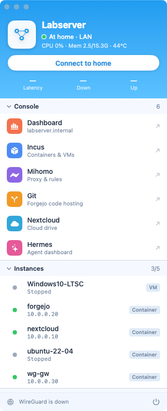
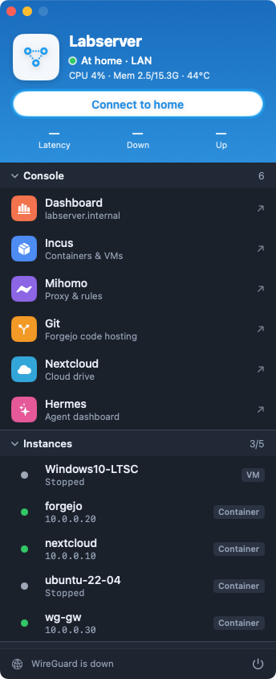
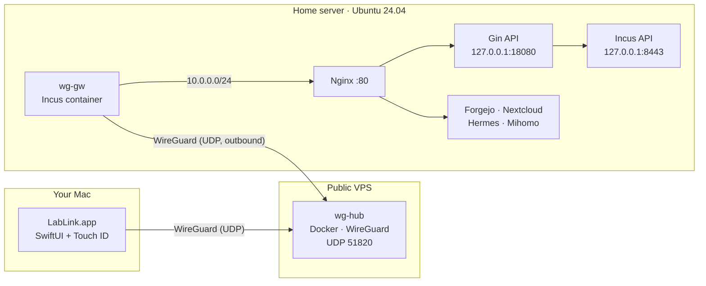
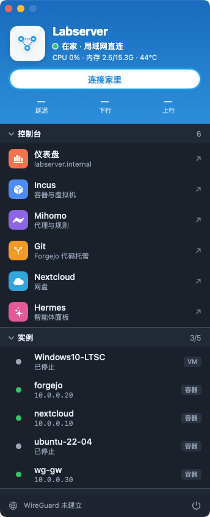

<div align="center">


# Labserver

**A read-only dashboard for your home server, plus a private WireGuard "back door" and a native macOS app to reach it from anywhere.**

English | [简体中文](README.zh-CN.md)

[](LICENSE)



&nbsp;&nbsp;


</div>

---

## ✨ What you get

| | Component | What it does |
|---|---|---|
| 📊 | **Dashboard** (`frontend/`, `backend/`) | Vue 3 + Vuetify UI over a small Go/Gin API. CPU, memory, disks, network, sensors, battery, top processes, Incus instances, service health, optional DeepSeek balance and Mihomo status. **Strictly read-only**: the API only issues `GET`s and never executes shell commands. |
| 🚪 | **Nginx gateway** (`deploy/nginx/`) | One port (`:80`), host-based sites: `labserver.internal`, `incus.`, `git.`, `nextcloud.`, `hermes.`, `mihomo.` |
| 🔒 | **Hardening** (`deploy/systemd`, `deploy/firewall`) | systemd sandboxing, a restricted Incus client certificate, and an nftables table that blocks direct-IP access to service ports. |
| 🌐 | **WireGuard overlay** (`deploy/wireguard/`) | Hub on a cheap public VPS (Docker), gateway in an Incus container at home. Both dial **out**, so no router changes or port forwarding. |
| 🍎 | **LabLink** (`mac/LabLink/`) | Native SwiftUI menu-panel app: one button to connect, instance list, one-click panels and SSH, light/dark, English/中文/日本語, **Touch ID** to bring the tunnel up. |
| 🧩 | **Extras** (`deploy/forgejo`, `deploy/hermes`, `deploy/mihomo*`) | Optional: self-hosted Git (Forgejo), Hermes Agent dashboard, Mihomo + MetaCubeXD, DeepSeek usage stats. |

## 🧭 Architecture



Overlay addresses used throughout this guide: hub `10.77.0.1`, home gateway `10.77.0.2`, Mac `10.77.0.3`.
The hub forwards **only** Mac ⇄ home gateway (default-drop firewall, no NAT), so it cannot be used as a general VPN or proxy.

## 📁 Repository layout

```
backend/            Go + Gin read-only API (metrics from /proc, Incus over a restricted client cert)
frontend/           Vue 3 + Vuetify 4 + TypeScript (pnpm build -> dist/)
deploy/
  nginx/            sites, one per hostname (+ connection_upgrade.conf)
  systemd/          hardened unit for the API
  firewall/         nftables table + unit
  services.json     the service registry shown on the Services page
  env.example       backend environment file
  wireguard/        hub (Docker) and home-gateway (Incus) configs
  forgejo/ hermes/ mihomo/ mihomo-ui/ dns/   optional pieces
  legacy-ssh-tunnel/   the old reverse-SSH design, kept as a fallback
mac/LabLink/        the macOS app (Swift Package, no Xcode project needed)
docs/images/        screenshots
```

## 🧰 Prerequisites

- **Home server**: Ubuntu 24.04 (or similar systemd distro) with [Incus](https://linuxcontainers.org/incus/) (6.0+), Nginx, `sudo`.
- **Build tools**: Go 1.22+, Node.js 22+ and [pnpm](https://pnpm.io/) (can be on your laptop; only the Go binary and `dist/` are copied).
- **For remote access** (optional): a VPS with a public IP and Docker, and the ability to open **UDP 51820** in its firewall.
- **Mac app** (optional): macOS 14+, Xcode or the Command Line Tools (Swift 5.9+), [Homebrew](https://brew.sh/).

> Throughout the guide, `labserver.internal` is the example base domain and `192.168.1.240` the example server address. Use your own.

---

## 🚀 Part 1 — Install the dashboard on the server

### 1. Service user and directories

```bash
sudo useradd --system --no-create-home --shell /usr/sbin/nologin labserver
sudo mkdir -p /opt/labserver-dashboard/{bin,web} /etc/labserver-dashboard
```

### 2. A restricted Incus client certificate (read-only access for the API)

```bash
incus config set core.https_address 127.0.0.1:8443     # API on loopback only

cd /tmp && openssl req -x509 -newkey ec -pkeyopt ec_paramgen_curve:secp384r1 -sha384 \
  -days 3650 -nodes -subj "/CN=labserver-dashboard" \
  -keyout incus-client.key -out incus-client.crt
incus config trust add-certificate incus-client.crt --restricted --projects default --name labserver-dashboard

sudo install -o root -g labserver -m 640 incus-client.crt incus-client.key /etc/labserver-dashboard/
shred -u incus-client.key; rm -f incus-client.crt
```

The backend only ever sends `GET` requests; the certificate is additionally limited to the `default` project.

### 3. Build and install

```bash
# backend
cd backend && go build -o labserver-dashboard ./cmd/server
sudo install -m 755 labserver-dashboard /opt/labserver-dashboard/bin/

# frontend
cd ../frontend && pnpm install && pnpm build
sudo rsync -a --delete dist/ /opt/labserver-dashboard/web/
```

Optional: put a photo at `frontend/public/wallpaper.jpg` *before* building to get the home-page hero image
(a gradient is used otherwise; no wallpaper ships with this repo).

### 4. Configure and start the API

```bash
cd ..   # repo root
sudo cp deploy/env.example /etc/labserver-dashboard/env
sudo cp deploy/services.json /etc/labserver-dashboard/services.json
sudo $EDITOR /etc/labserver-dashboard/env /etc/labserver-dashboard/services.json
sudo cp deploy/systemd/labserver-dashboard.service /etc/systemd/system/
sudo systemctl daemon-reload && sudo systemctl enable --now labserver-dashboard
curl -s http://127.0.0.1:18080/api/v1/health      # {"ok":true,"data":{"status":"ok"}}
```

Every integration is optional: delete the lines you do not use from `env` (`MIHOMO_URL`, `DEEPSEEK_KEY_FILE`, ...).
`services.json` supports four check kinds: `tcp`, `http`, `systemd` and `incus` (an instance's running state).

### 5. Nginx

```bash
sudo cp deploy/nginx/connection_upgrade.conf /etc/nginx/conf.d/
sudo cp deploy/nginx/labserver /etc/nginx/sites-available/
sudo ln -sf /etc/nginx/sites-available/labserver /etc/nginx/sites-enabled/
sudo rm -f /etc/nginx/sites-enabled/default           # labserver is the default_server
sudo nginx -t && sudo systemctl reload nginx
```

Optional sites, each a separate file you copy the same way after editing `server_name`/upstream:
`incus-ui` (needs the `incus-ui-canonical` package and a second client certificate in `/etc/nginx/incus-proxy/`),
`git`, `nextcloud-internal`, `hermes`, `mihomo` (see [`deploy/mihomo-ui/README.md`](deploy/mihomo-ui/README.md)).

### 6. Make the names resolve

Without a local DNS server, add a line to `/etc/hosts` on each client (see [`deploy/dns/mac-hosts.txt`](deploy/dns/mac-hosts.txt)):

```
192.168.1.240  labserver.internal incus.labserver.internal git.labserver.internal mihomo.labserver.internal nextcloud.labserver.internal hermes.labserver.internal
```

Open `http://labserver.internal`.

### 7. (Recommended) Block direct-IP access to service ports

```bash
sudo cp deploy/firewall/labserver-fw.nft /etc/labserver-fw.nft
sudo cp deploy/firewall/labserver-fw.service /etc/systemd/system/
sudo systemctl daemon-reload && sudo systemctl enable --now labserver-fw
```

This rejects `8080`, `8443` and `9090` from the network (loopback stays open) so everything goes through Nginx on `:80`.
Edit the port list to match your services.

---

## 🌐 Part 2 — Reach it from anywhere (WireGuard)

Both the home gateway and your Mac connect **out** to the VPS hub, so you do not touch the router.

### 1. VPS hub (Docker)

First open **UDP 51820** inbound in your cloud provider's firewall (for example a VPC firewall rule). Then:

```bash
# from your clone, copy the hub files to the VPS
scp -r deploy/wireguard/hub/. you@VPS_IP:/opt/wg-hub/

# on the VPS
cd /opt/wg-hub && mkdir -p config && umask 077
HUB_KEY=$(docker run --rm alpine:3.20 sh -c 'apk add -q --no-cache wireguard-tools && wg genkey')
HUB_PUB=$(printf %s "$HUB_KEY" | docker run --rm -i alpine:3.20 sh -c 'apk add -q --no-cache wireguard-tools && wg pubkey')
sed "s|__HUB_PRIVATE_KEY__|$HUB_KEY|" wg0.conf.tmpl > config/wg0.conf
echo "hub public key: $HUB_PUB"          # you need this for the next two steps
docker compose up -d --build
```

The hub's firewall rules (in `wg0.conf.tmpl`) allow only `10.77.0.3 ⇄ 10.77.0.2` and `10.77.0.3 ⇄ 10.0.0.0/24`.
If your Incus bridge uses another subnet, change it there and in `deploy/wireguard/gw/wg0.conf.tmpl`.

### 2. Home gateway (an Incus container)

On the home server, first set the two values from step 1 (`HUB_PUB` is public, safe to paste):

```bash
export VPS_IP=203.0.113.10 HUB_PUB='the hub public key printed above'
incus launch images:ubuntu/24.04 wg-gw
incus config device override wg-gw eth0 ipv4.address=10.0.0.30       # fixed address on incusbr0
incus config set wg-gw boot.autostart=true limits.memory=256MiB limits.cpu=1
incus exec wg-gw -- sh -c 'apt-get update -qq && apt-get install -y -qq wireguard-tools iptables'

# key pair stays inside the container; print the public key
incus exec wg-gw -- sh -c 'umask 077; mkdir -p /etc/wireguard; wg genkey | tee /etc/wireguard/gw.key | wg pubkey'
# -> note it as GW_PUB

GW_KEY=$(incus exec wg-gw -- cat /etc/wireguard/gw.key)
sed -e "s|__GW_PRIVATE_KEY__|$GW_KEY|" -e "s|<HUB_PUBLIC_KEY>|$HUB_PUB|" -e "s|<VPS_PUBLIC_IP>|$VPS_IP|" \
  deploy/wireguard/gw/wg0.conf.tmpl | incus file push --mode 0600 - wg-gw/etc/wireguard/wg0.conf
incus exec wg-gw -- systemctl enable --now wg-quick@wg0
```

> **If the server (or your Mac) runs a transparent proxy such as Clash/Mihomo in TUN mode**, add a rule that sends
> the VPS address straight out, as the **first** rule: `IP-CIDR,VPS_IP/32,DIRECT,no-resolve`. Otherwise the tunnel is
> routed through a proxy node and gets several times the latency.

### 3. Your Mac's key and config

```bash
export VPS_IP=203.0.113.10 HUB_PUB='the hub public key printed above'
brew install wireguard-tools
mkdir -p ~/.config/lablink && chmod 700 ~/.config/lablink && cd ~/.config/lablink && umask 077
wg genkey | tee mac.key | wg pubkey > mac.pub && cat mac.pub          # -> MAC_PUB
cat > lablink.conf <<EOF
[Interface]
PrivateKey = $(cat mac.key)
Address = 10.77.0.3/32

[Peer]
PublicKey = $HUB_PUB
Endpoint = $VPS_IP:51820
AllowedIPs = 10.77.0.0/24, 10.0.0.0/24
PersistentKeepalive = 25
EOF
```

### 4. Register both peers on the hub

On the VPS, append to `/opt/wg-hub/config/wg0.conf`, then `docker compose restart`:

```ini
[Peer]
# home gateway
PublicKey = GW_PUB
AllowedIPs = 10.77.0.2/32, 10.0.0.0/24

[Peer]
# Mac
PublicKey = MAC_PUB
AllowedIPs = 10.77.0.3/32
```

Check: `docker exec wg-hub wg show` should list a recent handshake for the gateway, and
`incus exec wg-gw -- ping -c3 10.77.0.1` should answer.

---

## 🍎 Part 3 — LabLink, the macOS app

<div align="center">

&nbsp;

</div>

### Download (DMG)

Release builds are one DMG per architecture, with `wg` and `wireguard-go` already bundled:

| File | Mac |
|---|---|
| `LabLink-<version>-arm64.dmg` | Apple silicon (M1 and later) |
| `LabLink-<version>-x86_64.dmg` | Intel (not built yet, see below) |

Verify with `shasum -a 256 -c SHA256SUMS`, open the DMG and drag **LabLink** to **Applications**.

The app is ad-hoc signed, **not notarized** (no paid Apple Developer ID), so macOS blocks the first launch of a downloaded
copy. Either open *System Settings → Privacy & Security* and press **Open Anyway**, or run:

```bash
xattr -dr com.apple.quarantine /Applications/LabLink.app
```

> **The DMG uses the default addresses from `Config.swift`** (`labserver.internal`, `192.168.1.240`, `10.77.0.x`, ...) and
> your macOS user name for SSH. If your network differs, build from source as below. Making these editable in the app
> is on the to-do list.

Build the DMGs yourself:

```bash
cd mac/LabLink
./scripts/release.sh                                  # dist/LabLink-<version>-arm64.dmg + SHA256SUMS
# Intel too (Homebrew has no Intel bottles, so wg / wireguard-go are built from source; wireguard-go needs Go 1.23+):
ARCH=x86_64 ./scripts/build-tools.sh && ARCHS="arm64 x86_64" ./scripts/release.sh
```

The Intel build has not been produced or tested yet.

### Build

```bash
brew install wireguard-tools          # provides wg and wireguard-go, which the app bundles
cd mac/LabLink
$EDITOR Sources/LabLink/Config.swift  # your domain, LAN address, tunnel addresses, SSH user
$EDITOR Resources/lablink-helper      # keep ADDR / NETS / HOMEIP / TUNIP at the top in sync with Config.swift
./scripts/build.sh                    # -> build/LabLink.app (ad-hoc signed)
cp -R build/LabLink.app /Applications/
```

The tunnel config is read from `~/.config/lablink/lablink.conf` (the file you made in Part 2).

### Use

1. Open **LabLink**. At home it shows *At home · LAN* and everything works over the LAN. Away, press **Connect to home**.
2. The first connect asks for your macOS password (the system admin prompt). To use your **fingerprint** instead,
   press **⌘ ,** → *Authorization* → **Touch ID** → *Install…* and enter your password once. From then on each connect
   or disconnect is confirmed with Touch ID.
3. Click a panel (Dashboard, Incus, Mihomo, Git, Nextcloud, Hermes) to open it in your browser, or **SSH** to open Terminal.
   Click an instance to copy its IP.
4. **⌘ ,** also sets the *Name* shown at the top, *Notify on connect / disconnect*, *Appearance* (auto / dark / light)
   and *Language* (follow system / English / 中文 / 日本語).
   The window can be resized within limits; it has no full-screen mode by design.
5. The frosted header shows the state at a glance: **green** at home, **grey** away and not connected, **red** while the
   tunnel is up. At home, **Connect** just tells you there is nothing to connect.
6. **⌘ W** only closes the window: the app keeps running with an icon in the menu bar (Show / Quit). **Hold ⌘ Q**
   for about a second to quit. A system notification appears when the tunnel connects or disconnects.

### What the Touch ID option installs

Everything is root-owned and removable with **Settings → Remove…**:

- `/usr/local/libexec/lablink/` — the helper script plus `wg` and `wireguard-go`
- `/usr/local/etc/lablink/lablink.conf` — a root-only copy of your tunnel config (mode 600)
- `/etc/sudoers.d/lablink` — passwordless `sudo` for **exactly** `lablink-helper up` and `lablink-helper down`

The fingerprint check happens in the app. Any process running as you could call those two commands without it, but all
they do is start or stop the tunnel and switch the `*.labserver.internal` lines in `/etc/hosts`. Choose
*Password each time* if you prefer nothing installed.

---

## 🧩 Optional pieces

| Piece | Where | Notes |
|---|---|---|
| Forgejo (self-hosted Git) | `deploy/forgejo/` | Run in an Incus container; edit `app.ini.tmpl` (domain, paths) and use the `git` nginx site. |
| Hermes Agent dashboard | `deploy/hermes/` | `hermes-dashboard.service` (replace `YOUR_USER`) behind the `hermes` nginx site; `usage-export.py` feeds token stats to the dashboard. |
| Mihomo + MetaCubeXD | `deploy/mihomo/`, `deploy/mihomo-ui/` | `to-subscription.py` converts a static Mihomo config to subscription mode. |
| DeepSeek usage panel | `DEEPSEEK_KEY_FILE` in `env` | Reads the balance endpoint only; spending is derived from balance changes. Use a dedicated key. |
| Legacy SSH tunnel | `deploy/legacy-ssh-tunnel/` | The earlier reverse-SSH design; superseded by WireGuard. |

## 🛡️ Security model

- The API listens on `127.0.0.1` only, runs as an unprivileged user with `NoNewPrivileges`, `ProtectSystem=strict`, `ProtectHome` and no capabilities.
- It is read-only by construction: it never executes shell commands and talks to Incus with a project-restricted certificate using `GET` only.
- No secrets in the browser: tokens and certificates stay server-side.
- Remote access exposes a single UDP port on the VPS. Unauthenticated packets get no reply; only keyed peers are accepted.
- The VPS hub is default-drop and forwards only between your two peers.
- Keep `*.key`, `wg0.conf`, `lablink.conf` and `env` out of version control (they are in `.gitignore`).

## 🩺 Troubleshooting

| Symptom | Check |
|---|---|
| `nginx -t` fails on `$connection_upgrade` | Install `deploy/nginx/connection_upgrade.conf` into `/etc/nginx/conf.d/`. |
| No handshake on the hub | Is UDP 51820 open in the **cloud** firewall? Test: run a UDP echo on the VPS and send to it from outside. |
| Tunnel works but is slow | A transparent proxy is carrying the WireGuard UDP. Add the `DIRECT` rule from Part 2 on both ends. |
| Port tests always "succeed" | Fake-IP proxies (Clash/Mihomo TUN) accept any TCP connection locally; test with a real application request instead. |
| Panels do not resolve | `/etc/hosts` must map the names to your server; LabLink rewrites those lines between LAN and tunnel automatically. |
| macOS asks about local network | Allow it; LabLink needs it to read the dashboard. |
| Every address shows the dashboard | Nginx picks the site by host name. Open `incus.labserver.internal`, not the bare IP. |

## 📜 License

[MIT](LICENSE) © 2026 Kazuma-Kobayashi01.

Third-party: [MetaCubeXD](https://github.com/MetaCubeX/metacubexd) (MIT), [Vuetify](https://vuetifyjs.com/) (MIT),
[Gin](https://github.com/gin-gonic/gin) (MIT), [Incus](https://linuxcontainers.org/incus/) (Apache-2.0),
[Forgejo](https://forgejo.org/) (GPL-3.0). *WireGuard* is a registered trademark of Jason A. Donenfeld.
