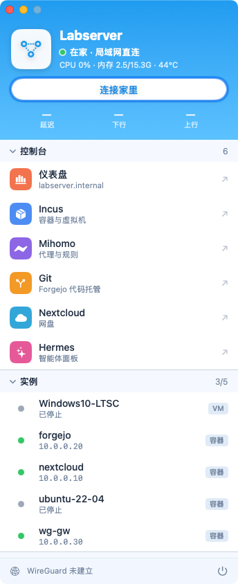
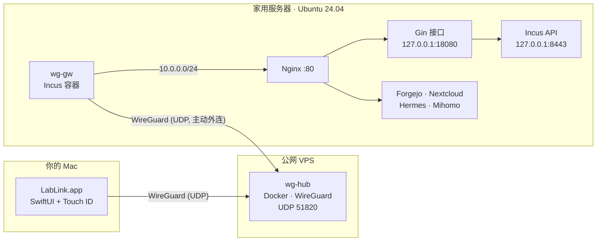

<div align="center">


# Labserver

**家用服务器的只读仪表盘 + 私有 WireGuard 回家通道 + 随时随地连接的原生 macOS 应用。**

[English](README.md) | 简体中文

[](LICENSE)



&nbsp;&nbsp;


</div>

---

## ✨ 你会得到什么

| | 组件 | 作用 |
|---|---|---|
| 📊 | **仪表盘**(`frontend/`、`backend/`) | Vue 3 + Vuetify 界面,背后是一个很小的 Go/Gin 接口。展示 CPU、内存、磁盘、网络、传感器、电池、进程排行、Incus 实例、服务健康度,以及可选的 DeepSeek 余额和 Mihomo 状态。**严格只读**:接口只发 `GET`,从不执行 shell 命令。 |
| 🚪 | **Nginx 网关**(`deploy/nginx/`) | 只开一个端口(`:80`),按域名分站:`labserver.internal`、`incus.`、`git.`、`nextcloud.`、`hermes.`、`mihomo.` |
| 🔒 | **加固**(`deploy/systemd`、`deploy/firewall`) | systemd 沙箱、受限的 Incus 客户端证书、nftables 规则阻止通过 IP 直连服务端口。 |
| 🌐 | **WireGuard 虚拟组网**(`deploy/wireguard/`) | 便宜的公网 VPS 上跑 Docker 中转点,家里跑一个 Incus 网关容器。两边都是**主动向外连接**,不用改路由器、不用端口转发。 |
| 🍎 | **LabLink**(`mac/LabLink/`) | 原生 SwiftUI 面板应用:一键连接、实例列表、一键打开面板和 SSH、深浅色、English/中文/日本語,用 **Touch ID** 确认建立隧道。 |
| 🧩 | **可选组件**(`deploy/forgejo`、`deploy/hermes`、`deploy/mihomo*`) | 自托管 Git(Forgejo)、Hermes Agent 面板、Mihomo + MetaCubeXD、DeepSeek 用量统计。 |

## 🧭 架构



本文统一使用的虚拟网段地址:中转点 `10.77.0.1`、家里网关 `10.77.0.2`、Mac `10.77.0.3`。
中转点**只**转发 Mac ⇄ 家里网关(默认丢弃、不做 NAT),所以它不能被当成通用 VPN 或代理使用。

## 📁 仓库结构

```
backend/            Go + Gin 只读接口(从 /proc 读指标,用受限客户端证书访问 Incus)
frontend/           Vue 3 + Vuetify 4 + TypeScript(pnpm build -> dist/)
deploy/
  nginx/            每个域名一个站点(含 connection_upgrade.conf)
  systemd/          接口服务的加固单元
  firewall/         nftables 规则 + 服务单元
  services.json     「服务」页面显示的服务清单
  env.example       后端环境变量示例
  wireguard/        中转点(Docker)与家里网关(Incus)配置
  forgejo/ hermes/ mihomo/ mihomo-ui/ dns/   可选组件
  legacy-ssh-tunnel/   早期的反向 SSH 方案,留作备用
mac/LabLink/        macOS 应用(Swift Package,不需要 Xcode 工程)
docs/images/        截图
```

## 🧰 准备工作

- **家用服务器**:Ubuntu 24.04(或类似的 systemd 发行版),装好 [Incus](https://linuxcontainers.org/incus/)(6.0+)、Nginx,有 `sudo`。
- **构建工具**:Go 1.22+、Node.js 22+、[pnpm](https://pnpm.io/)(可以在你的电脑上构建,只需把 Go 二进制和 `dist/` 拷到服务器)。
- **远程访问**(可选):一台有公网 IP、装了 Docker 的 VPS,并且能在它的防火墙里放行 **UDP 51820**。
- **Mac 应用**(可选):macOS 14+,Xcode 或命令行工具(Swift 5.9+),[Homebrew](https://brew.sh/)。

> 全文中 `labserver.internal` 是示例基础域名,`192.168.1.240` 是示例服务器地址,请换成你自己的。

---

## 🚀 第一部分:在服务器上安装仪表盘

### 1. 服务用户和目录

```bash
sudo useradd --system --no-create-home --shell /usr/sbin/nologin labserver
sudo mkdir -p /opt/labserver-dashboard/{bin,web} /etc/labserver-dashboard
```

### 2. 受限的 Incus 客户端证书(给接口只读访问)

```bash
incus config set core.https_address 127.0.0.1:8443     # API 只监听回环地址

cd /tmp && openssl req -x509 -newkey ec -pkeyopt ec_paramgen_curve:secp384r1 -sha384 \
  -days 3650 -nodes -subj "/CN=labserver-dashboard" \
  -keyout incus-client.key -out incus-client.crt
incus config trust add-certificate incus-client.crt --restricted --projects default --name labserver-dashboard

sudo install -o root -g labserver -m 640 incus-client.crt incus-client.key /etc/labserver-dashboard/
shred -u incus-client.key; rm -f incus-client.crt
```

后端只会发送 `GET` 请求,证书还额外限制在 `default` 项目内。

### 3. 构建并安装

```bash
# 后端
cd backend && go build -o labserver-dashboard ./cmd/server
sudo install -m 755 labserver-dashboard /opt/labserver-dashboard/bin/

# 前端
cd ../frontend && pnpm install && pnpm build
sudo rsync -a --delete dist/ /opt/labserver-dashboard/web/
```

可选:构建**之前**把一张照片放到 `frontend/public/wallpaper.jpg`,首页就会有背景图
(没有的话使用渐变底色;本仓库不附带任何壁纸)。

### 4. 配置并启动接口

```bash
cd ..   # 回到仓库根目录
sudo cp deploy/env.example /etc/labserver-dashboard/env
sudo cp deploy/services.json /etc/labserver-dashboard/services.json
sudo $EDITOR /etc/labserver-dashboard/env /etc/labserver-dashboard/services.json
sudo cp deploy/systemd/labserver-dashboard.service /etc/systemd/system/
sudo systemctl daemon-reload && sudo systemctl enable --now labserver-dashboard
curl -s http://127.0.0.1:18080/api/v1/health      # {"ok":true,"data":{"status":"ok"}}
```

所有集成都是可选的:不用的就从 `env` 里删掉对应行(`MIHOMO_URL`、`DEEPSEEK_KEY_FILE` 等)。
`services.json` 支持四种检查类型:`tcp`、`http`、`systemd`、`incus`(某个实例是否在运行)。

### 5. Nginx

```bash
sudo cp deploy/nginx/connection_upgrade.conf /etc/nginx/conf.d/
sudo cp deploy/nginx/labserver /etc/nginx/sites-available/
sudo ln -sf /etc/nginx/sites-available/labserver /etc/nginx/sites-enabled/
sudo rm -f /etc/nginx/sites-enabled/default           # labserver 是 default_server
sudo nginx -t && sudo systemctl reload nginx
```

可选站点各是一个独立文件,改好 `server_name` 和上游地址后用同样方式安装:
`incus-ui`(需要 `incus-ui-canonical` 软件包,以及放在 `/etc/nginx/incus-proxy/` 的第二张客户端证书)、
`git`、`nextcloud-internal`、`hermes`、`mihomo`(见 [`deploy/mihomo-ui/README.md`](deploy/mihomo-ui/README.md))。

### 6. 让域名能解析

没有本地 DNS 的话,在每台客户端的 `/etc/hosts` 里加一行(参考 [`deploy/dns/mac-hosts.txt`](deploy/dns/mac-hosts.txt)):

```
192.168.1.240  labserver.internal incus.labserver.internal git.labserver.internal mihomo.labserver.internal nextcloud.labserver.internal hermes.labserver.internal
```

然后打开 `http://labserver.internal`。

### 7.(推荐)禁止通过 IP 直连服务端口

```bash
sudo cp deploy/firewall/labserver-fw.nft /etc/labserver-fw.nft
sudo cp deploy/firewall/labserver-fw.service /etc/systemd/system/
sudo systemctl daemon-reload && sudo systemctl enable --now labserver-fw
```

它会拒绝来自网络的 `8080`、`8443`、`9090`(回环不受影响),所有访问都走 `:80` 上的 Nginx。
端口列表请按你的服务修改。

---

## 🌐 第二部分:随时随地访问(WireGuard)

家里网关和你的 Mac 都**主动连出**到 VPS 中转点,所以不用动路由器。

### 1. VPS 中转点(Docker)

先在云厂商的防火墙里放行入站 **UDP 51820**(例如 VPC 防火墙规则)。然后:

```bash
# 在你的仓库目录,把中转点文件拷到 VPS
scp -r deploy/wireguard/hub/. you@VPS_IP:/opt/wg-hub/

# 在 VPS 上
cd /opt/wg-hub && mkdir -p config && umask 077
HUB_KEY=$(docker run --rm alpine:3.20 sh -c 'apk add -q --no-cache wireguard-tools && wg genkey')
HUB_PUB=$(printf %s "$HUB_KEY" | docker run --rm -i alpine:3.20 sh -c 'apk add -q --no-cache wireguard-tools && wg pubkey')
sed "s|__HUB_PRIVATE_KEY__|$HUB_KEY|" wg0.conf.tmpl > config/wg0.conf
echo "hub public key: $HUB_PUB"          # 后面两步要用
docker compose up -d --build
```

中转点的防火墙规则(在 `wg0.conf.tmpl` 里)只允许 `10.77.0.3 ⇄ 10.77.0.2` 和 `10.77.0.3 ⇄ 10.0.0.0/24`。
如果你的 Incus 网桥用了别的网段,请在这里以及 `deploy/wireguard/gw/wg0.conf.tmpl` 里一并修改。

### 2. 家里网关(一个 Incus 容器)

在家用服务器上,先设置第 1 步得到的两个值(`HUB_PUB` 是公开信息,可以直接粘贴):

```bash
export VPS_IP=203.0.113.10 HUB_PUB='上面打印出的中转点公钥'
incus launch images:ubuntu/24.04 wg-gw
incus config device override wg-gw eth0 ipv4.address=10.0.0.30       # 在 incusbr0 上固定地址
incus config set wg-gw boot.autostart=true limits.memory=256MiB limits.cpu=1
incus exec wg-gw -- sh -c 'apt-get update -qq && apt-get install -y -qq wireguard-tools iptables'

# 密钥对留在容器里,只打印公钥
incus exec wg-gw -- sh -c 'umask 077; mkdir -p /etc/wireguard; wg genkey | tee /etc/wireguard/gw.key | wg pubkey'
# -> 记作 GW_PUB

GW_KEY=$(incus exec wg-gw -- cat /etc/wireguard/gw.key)
sed -e "s|__GW_PRIVATE_KEY__|$GW_KEY|" -e "s|<HUB_PUBLIC_KEY>|$HUB_PUB|" -e "s|<VPS_PUBLIC_IP>|$VPS_IP|" \
  deploy/wireguard/gw/wg0.conf.tmpl | incus file push --mode 0600 - wg-gw/etc/wireguard/wg0.conf
incus exec wg-gw -- systemctl enable --now wg-quick@wg0
```

> **如果服务器(或你的 Mac)在用 Clash/Mihomo 的 TUN 透明代理**,必须加一条让 VPS 地址直连的规则,并放在规则**最前面**:
> `IP-CIDR,VPS_IP/32,DIRECT,no-resolve`。否则隧道会被转进代理节点,延迟会高出好几倍。

### 3. 你的 Mac 的密钥和配置

```bash
export VPS_IP=203.0.113.10 HUB_PUB='上面打印出的中转点公钥'
brew install wireguard-tools
mkdir -p ~/.config/lablink && chmod 700 ~/.config/lablink && cd ~/.config/lablink && umask 077
wg genkey | tee mac.key | wg pubkey > mac.pub && cat mac.pub          # -> 记作 MAC_PUB
cat > lablink.conf <<EOF
[Interface]
PrivateKey = $(cat mac.key)
Address = 10.77.0.3/32

[Peer]
PublicKey = $HUB_PUB
Endpoint = $VPS_IP:51820
AllowedIPs = 10.77.0.0/24, 10.0.0.0/24
PersistentKeepalive = 25
EOF
```

### 4. 在中转点登记两个节点

在 VPS 上,把下面内容追加到 `/opt/wg-hub/config/wg0.conf`,然后执行 `docker compose restart`:

```ini
[Peer]
# 家里网关
PublicKey = GW_PUB
AllowedIPs = 10.77.0.2/32, 10.0.0.0/24

[Peer]
# Mac
PublicKey = MAC_PUB
AllowedIPs = 10.77.0.3/32
```

检查:`docker exec wg-hub wg show` 应该能看到网关最近的握手;
`incus exec wg-gw -- ping -c3 10.77.0.1` 应该有回应。

---

## 🍎 第三部分:LabLink,macOS 应用

<div align="center">

&nbsp;

</div>

### 下载(DMG)

发布版按架构各打一个 DMG,已经内置了 `wg` 和 `wireguard-go`:

| 文件 | 适用的 Mac |
|---|---|
| `LabLink-<版本>-arm64.dmg` | Apple 芯片(M1 及以后) |
| `LabLink-<版本>-x86_64.dmg` | Intel(目前还没有构建,见下) |

用 `shasum -a 256 -c SHA256SUMS` 校验,打开 DMG,把 **LabLink** 拖进 **应用程序**。

应用是 ad-hoc 签名、**没有经过公证**(没有付费的 Apple 开发者账号),所以 macOS 会拦截下载来的副本首次启动。
可以打开 *系统设置 → 隐私与安全性*,点 **仍要打开**;或者执行:

```bash
xattr -dr com.apple.quarantine /Applications/LabLink.app
```

> **DMG 里用的是 `Config.swift` 里的默认地址**(`labserver.internal`、`192.168.1.240`、`10.77.0.x` 等),
> SSH 用户名取你的 macOS 用户名。如果你的网络不一样,请按下面的方式从源码构建。让这些地址能在应用里直接修改,已在计划中。

自己打 DMG:

```bash
cd mac/LabLink
./scripts/release.sh                                  # dist/LabLink-<版本>-arm64.dmg + SHA256SUMS
# 同时打 Intel(Homebrew 已不再提供 Intel 预编译包,所以 wg / wireguard-go 需要从源码编译;wireguard-go 要 Go 1.23+):
ARCH=x86_64 ./scripts/build-tools.sh && ARCHS="arm64 x86_64" ./scripts/release.sh
```

Intel 版目前还没有构建,也没有测试过。

### 构建

```bash
brew install wireguard-tools          # 提供 wg 和 wireguard-go,应用会把它们打包进去
cd mac/LabLink
$EDITOR Sources/LabLink/Config.swift  # 你的域名、局域网地址、隧道地址、SSH 用户名
$EDITOR Resources/lablink-helper      # 文件开头的 ADDR / NETS / HOMEIP / TUNIP 要和 Config.swift 保持一致
./scripts/build.sh                    # -> build/LabLink.app(ad-hoc 签名)
cp -R build/LabLink.app /Applications/
```

隧道配置读取自 `~/.config/lablink/lablink.conf`(就是第二部分里你创建的那个文件)。

### 使用

1. 打开 **LabLink**。在家时显示"在家 · 局域网直连",一切走局域网。外出时点 **连接家里**。
2. 第一次连接会要求输入 macOS 密码(系统管理员授权框)。想改用**指纹**:按 **⌘ ,** → "授权方式" → **指纹 (Touch ID)** → "安装…",输入一次密码。
   之后每次连接或断开都用 Touch ID 确认。
3. 点击面板(仪表盘、Incus、Mihomo、Git、Nextcloud、Hermes)会在浏览器里打开,点 **SSH** 会打开终端;点击某个实例会复制它的 IP。
4. **⌘ ,** 里还能设置顶部显示的 *名称*、*连接、断开时发送通知*、*外观*(自动 / 深色 / 浅色)和 *语言*(跟随系统 / English / 中文 / 日本語)。
   窗口可以在一定范围内缩放,设计上没有全屏模式。
5. 顶部的毛玻璃区域用颜色表示状态:在家是**绿色**,外出且未连接是**灰色**,隧道已连上是**红色**。在家时点 **连接** 只会提示无需连接。
6. **⌘ W** 只关闭窗口,程序继续在后台运行,菜单栏有图标(显示 / 退出)。**按住 ⌘ Q** 约 1 秒才会退出。隧道连上或断开时会发系统通知。

### 指纹选项会往系统里装什么

全部归 root 所有,可以在 **设置 → 卸载…** 里一键移除:

- `/usr/local/libexec/lablink/`:助手脚本,以及 `wg`、`wireguard-go`
- `/usr/local/etc/lablink/lablink.conf`:你的隧道配置的 root 专属副本(权限 600)
- `/etc/sudoers.d/lablink`:只对 `lablink-helper up` 和 `lablink-helper down` **这两个命令**免密 `sudo`

指纹校验发生在应用里。以你身份运行的其他进程理论上也可以绕过校验直接调用这两个命令,但它们只能启动或停止隧道,
以及切换 `/etc/hosts` 里 `*.labserver.internal` 那几行。如果你不想装任何东西,选择 *每次输入密码* 即可。

---

## 🧩 可选组件

| 组件 | 位置 | 说明 |
|---|---|---|
| Forgejo(自托管 Git) | `deploy/forgejo/` | 跑在一个 Incus 容器里;修改 `app.ini.tmpl`(域名、路径),配合 `git` 这个 nginx 站点。 |
| Hermes Agent 面板 | `deploy/hermes/` | `hermes-dashboard.service`(把 `YOUR_USER` 换成你的用户名),配合 `hermes` 站点;`usage-export.py` 把 token 统计喂给仪表盘。 |
| Mihomo + MetaCubeXD | `deploy/mihomo/`、`deploy/mihomo-ui/` | `to-subscription.py` 把静态 Mihomo 配置转成订阅模式。 |
| DeepSeek 用量面板 | `env` 里的 `DEEPSEEK_KEY_FILE` | 只读取余额接口;花费由余额变化推算。请使用专用密钥。 |
| 旧的 SSH 隧道 | `deploy/legacy-ssh-tunnel/` | 早期的反向 SSH 方案,已被 WireGuard 取代。 |

## 🛡️ 安全模型

- 接口只监听 `127.0.0.1`,以无特权用户运行,启用 `NoNewPrivileges`、`ProtectSystem=strict`、`ProtectHome`,不带任何 capability。
- 设计上就是只读:从不执行 shell 命令,只用按项目受限的证书、以 `GET` 访问 Incus。
- 浏览器里没有任何密钥:令牌和证书都只在服务器端。
- 远程访问只在 VPS 上暴露一个 UDP 端口,未认证的数据包不会得到任何回应,只接受持有密钥的节点。
- VPS 中转点默认丢弃,只在你的两个节点之间转发。
- 请不要把 `*.key`、`wg0.conf`、`lablink.conf`、`env` 提交到版本库(`.gitignore` 已经排除)。

## 🩺 常见问题

| 现象 | 排查 |
|---|---|
| `nginx -t` 报 `$connection_upgrade` 错误 | 把 `deploy/nginx/connection_upgrade.conf` 装到 `/etc/nginx/conf.d/`。 |
| 中转点上没有握手 | **云防火墙**里放行 UDP 51820 了吗?可以在 VPS 上起一个 UDP 回显,从外部发包测试。 |
| 隧道能通但很慢 | 有透明代理在承载 WireGuard 的 UDP。按第二部分在两端都加上 `DIRECT` 规则。 |
| 端口测试永远"成功" | Fake-IP 类代理(Clash/Mihomo TUN)会在本地接受任意 TCP 连接,要用真实的应用请求来测试。 |
| 面板域名解析不了 | `/etc/hosts` 要把域名指向你的服务器;LabLink 会在局域网/隧道之间自动改写这几行。 |
| macOS 询问本地网络权限 | 请允许,LabLink 需要它来读取仪表盘数据。 |
| 所有地址都显示仪表盘 | Nginx 按域名选站点。请打开 `incus.labserver.internal`,而不是直接用 IP。 |

## 📜 许可证

[MIT](LICENSE) © 2026 Kazuma-Kobayashi01。

第三方:[MetaCubeXD](https://github.com/MetaCubeX/metacubexd)(MIT)、[Vuetify](https://vuetifyjs.com/)(MIT)、
[Gin](https://github.com/gin-gonic/gin)(MIT)、[Incus](https://linuxcontainers.org/incus/)(Apache-2.0)、
[Forgejo](https://forgejo.org/)(GPL-3.0)。*WireGuard* 是 Jason A. Donenfeld 的注册商标。
