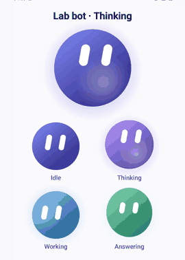

# LabLink for Android: design notes

What the app is: **an AI companion first, a home-lab remote second.** People open it to talk to a bot; the panels and
the tunnel are the reason the bot (and the panels) are reachable at all. The layout follows that order.

## What we borrowed, and from whom

| Product | What they do | What we took |
|---|---|---|
| Gemini, ChatGPT, Claude (Android) | Chat is the home screen; no bottom bar; a drawer holds history and settings; the model/bot name with ▾ in the top bar switches it | Chat as home, drawer navigation, bot switcher in the title |
| Gemini, Claude | The assistant's reply is plain full-width text (not a bubble); only the user's message sits in a soft bubble | Same: replies read like a page, the user bubble is tonal |
| Grok, Gemini | The composer is one big rounded container, tools inside it, a round send button | One 28 dp container, round send that morphs into a stop square |
| Grok | Empty screen = one big question, centered | Hero empty state: the bot's orb, its greeting, 2×2 suggestion cards |
| Character.AI, GPTs | Bots are visual: big avatar cards; creating one is its own full screen with a live preview | Bot editor with a live orb, colour swatches, template cards |
| Tailscale | Connection is one switch at the top; devices are a simple list; settings are grouped rows | Connection card with a switch (drawer + Home lab), grouped settings |
| Material 3 Expressive | Shape variety, emphasized type, contained content, spring motion, one or two "hero moments" | Big emphasized headlines, mixed shapes for panel tiles, springs, hero = the orb and its moods |

## The logo and its moods

A flat gradient orb with two slanted pill eyes (the "orb with eyes" idea, as in Grok's mascot), in our violet. No ring,
no gloss: it has to read at 24 dp and work in one colour for themed icons. Every bot gets its own orb colour.

The orb is the bot's face, so it shows what the bot is doing (`OrbMood` in `ui/BotAvatar.kt`):

| Mood | When | Motion |
|---|---|---|
| Idle | nothing happening | still; the hero orb (empty chat, editor, top bar) blinks every few seconds |
| Thinking | waiting for the first words (reasoning) | eyes drift up and around, the body breathes, a soft glow pulses, light sweeps round inside the orb |
| Working | the agent is using a tool (web search) | eyes scan left and right as if reading, faster light sweep |
| Answering | text is streaming in | happy half-closed eyes, a light bounce, a squash-and-stretch each time a new chunk arrives |

Moods blend on springs. Orbs in lists stay static when idle, so an idle screen draws no frames. A debug build shows all
moods side by side: `adb shell am start -n com.labserver.lablink/.MainActivity --ez orb_playground true`.

## Rules of thumb used in the code

* Corners: 28 dp for containers, 50 % for buttons and the orb, mixed shapes only for decorative tiles.
* Colour: a fixed brand palette (violet primary, lavender secondary, amber tertiary), not wallpaper colours, which gave
  grey low-contrast selections; each bot's own colour for its orb.
* Type: `headlineMedium` / `titleLarge` with heavier weight for hero text; body text stays `bodyLarge`.
* Motion: springs for size, shape and mood changes; only the hero orb blinks while idle, everything else loops only
  while the bot is busy.
