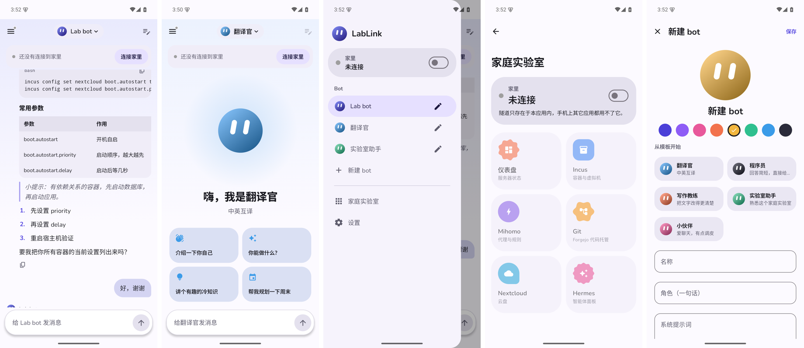

# LabLink for Android (+ Lab bot)

A native Android app (Kotlin, Jetpack Compose, **Material 3**, with Material 3 Expressive touches). Chat is the home
screen, as in Gemini, ChatGPT and Claude; everything else is in the navigation drawer. Design notes and what was
borrowed from which product: [DESIGN.md](DESIGN.md).



| Where | What it does |
|---|---|
| **Chat** (home) | Talk to the current bot: streamed replies as full-width text, collapsible "thoughts", light Markdown, one big rounded composer. Tap the bot's name in the top bar to switch, edit or add a bot. |
| **Bots** (drawer) | Several bots, each with its own name, one-line role, system prompt, orb colour and conversation. The editor starts from templates (translator, coder, writing coach, lab helper, buddy) and previews the bot live. |
| **Home lab** (drawer) | The connection switch, then Dashboard, Incus, Mihomo, Git, Nextcloud and Hermes as tiles. They open in an in-app WebView, **never** in the phone's browser. |
| **Settings** (drawer) | This device's public key, hub settings, Lab bot address and key. |

## The tunnel lives inside the app

Normal VPN and proxy apps use Android's `VpnService`, which takes over the whole phone. LabLink does not:

* WireGuard (wireguard-go on a userspace TCP/IP stack) runs **in the app process**. No VPN permission, no key icon in the
  status bar, no effect on other apps. Close the app and the tunnel is gone.
* The app reaches home through a small HTTP proxy bound to `127.0.0.1` on a random port. The WebView is pointed at it
  (`ProxyController`, with no DIRECT fallback) and so is the chat client.
* The proxy only dials the home domain (`*.labserver.internal`) and the tunnel host, only on ports 80/443. Anything
  else gets a 502, so another app that finds the port still cannot use it as a gateway.
* WebViews can only navigate to the home domain.
* Secrets (the device's WireGuard private key, the Lab bot key) are encrypted with an Android Keystore key. The private
  key is generated on the phone and never leaves it; only the public key is given to the hub.

```
Lab bot chat ──┐                      ┌── hub (VPS) ── home gateway ── nginx ── Hermes API :8642 (/p/labbot/)
Panels WebView ┴─ 127.0.0.1:proxy ─ in-app WireGuard (UDP 51820) ─┘
```

## Build

You need the Android SDK (platform 37, NDK), a JDK 17+, and Go for the tunnel library.

```bash
brew install go
go install golang.org/x/mobile/cmd/gomobile@latest golang.org/x/mobile/cmd/gobind@latest
./tunnel/build-aar.sh              # builds app/libs/labtunnel.aar (arm64 phones + x86_64 emulator)
./gradlew assembleDebug            # app/build/outputs/apk/debug/app-debug.apk
```

Install with `adb install -r app/build/outputs/apk/debug/app-debug.apk` or copy the APK to the phone. The tunnel library
can also be tried on a desktop: `go run ./tunnel/cmd/labtunnel-cli config.json` prints the proxy port; then
`curl -x http://127.0.0.1:<port> http://labserver.internal/`.

## First run

1. **Settings** (drawer) → copy the **public key** (the phone generates its own key pair).
2. On the server side, add the phone as a WireGuard device: `deploy/wireguard/add-device.sh` (see that README).
3. **Settings** → fill in the hub's public key, the TCP relay (`wss://host:port`) and its secret; the tunnel always runs over TCP through the bundled wstunnel (run `scripts/fetch-wstunnel.sh` once before building). Or copy a wg-quick config to the
   clipboard and tap **Paste a config**. The default overlay address is `10.77.0.4`.
4. Lab bot: set the API key (see `deploy/hermes/labbot.md`); the default address is `http://bot.<domain>/p/labbot/v1`.
5. **Connect to home**. Panels and Lab bot work while it says *Connected*.

## Notes

* Plain HTTP is allowed only for the home hosts and the loopback proxy (`res/xml/network_security_config.xml`). If you
  use a different home domain, change it there as well as in **Settings → Advanced**.
* The logo is a flat orb with two slanted pill eyes (`ui/BotAvatar.kt`, `res/drawable/ic_launcher_foreground.xml`). Each
  bot gets its own orb colour, and the orb acts out what the bot is doing: thinking, searching, answering
  (see [DESIGN.md](DESIGN.md)).
* `./gradlew assembleRelease` builds `app-release.apk` (0.4.0). It is signed with `android/keystore.properties` (git-ignored: `storeFile`, `storePassword`, `keyAlias`, `keyPassword`) when that file exists, otherwise with the local Android debug key, so it updates an installed debug build in place. Switching to a real key later means uninstalling once (the signature changes).
* Not done yet: a foreground service to keep the tunnel alive in the background, light/dark WebView theming, file
  downloads from panels.

## Sandbox bots

Besides the local default `Lab` bot, the app lists the **sandbox bots** kept by the server's bot-manager
(`deploy/bot-manager`, at most 5): create, edit, delete (to the trash for 7 days, then restore or delete for good),
and chat through the manager. Fill in the bot manager key in Settings (or paste a `[manager]` section with `Key = ...`);
the address defaults to `http://bot.<domain>/m/v1`. Their prompts live on the server, the conversations on the phone.
Debug builds can point the manager address at `http://10.0.2.2:<port>` (an emulator reaching the Mac) to test without the tunnel.
Unit tests: `./gradlew testDebugUnitTest`.

## Model, thinking level and Markdown

A tag under the message box shows the model and thinking level of this chat (default: the bot's own, else the server's); it opens a
sheet with the models by provider and the levels the chosen model accepts. The bot editor sets the bot's default. The catalog comes
from the bot manager (`/m/v1/models`) and is cached. Messages (yours too) are shown as Markdown: all heading levels, bold, italic,
strikethrough, inline code, links, nested and task lists, quotes, tables, rules, and fenced code in a box with a copy button and
syntax colours (`diff` shows added and removed lines). The parser and the highlighter are plain Kotlin with unit tests.

## Pictures and files

The **+** under the message box takes a photo, picks photos (several) or any file; share from other apps to LabLink works too. What is
attached sits above the text field as thumbnails and file pills (each with a remove button, a spinner while it is being worked on, and the
reason when it failed), and in the sent message above the words; tap a picture to see it big.
* Pictures are shrunk to 1568 px and re-encoded as JPEG, at most 4 per message, and sent inline; only the latest two messages that
  carry pictures send them again, older ones are just named.
* Text files up to 128 KB (code, md, json, csv, logs ...) are put into the message as `<file name="...">` blocks, for every bot.
* Any other file (up to 25 MB) is uploaded to the sandbox bot (`POST /m/v1/bots/{id}/files`), which lands in its `attachments` folder, seen by the
  sandbox as `/root/.hermes/attachments/<name>`; the message tells the bot the path. The default Lab bot has no sandbox, so it takes
  pictures and text files only.
The bytes live in the app's private storage (`files/attachments`) and go with the chat when it is cleared or the bot is removed.

## Library

Everything you send (pictures, text files, other files) is kept in the **Library** (drawer), newest first, with filters for pictures and files.
New chat clears only the words and the context: what was sent stays in the Library until you delete it there. Long-press to select (or tap a
file); then **send again** puts the picks into the message being written, or **delete** removes them for good (older messages then show them
empty). The **+** menu has "From the library" too. A file already uploaded to the same sandbox bot is reused, another bot gets its own upload.
Files that nothing refers to (a failed upload, a removed chip) are cleaned up at start, except from the last ten minutes.

## The orb's ten moves (`ui/BotAvatar.kt`)

Idle blink, thinking, searching, answering (set by the chat), sleepy (a hero orb left alone for 20 s dozes off with little z's) and
error (a shake of the head when a reply failed); and by touch on a hero orb (empty chat, bot editor): press and hold = squint-smile with
blushing cheeks, tap = roll / jelly wobble / hop in turn. `adb shell am start -n com.labserver.lablink/.MainActivity --ez orb_playground true`
(debug builds) shows all ten.
